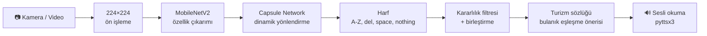

<div align="center">

# 🤟 SignCast — Sessiz Kelimeler

**Türk işaret dili parmak alfabesini kamera ile gerçek zamanlı harfe, kelimeye ve sesli cümleye çeviren yapay zeka sistemi.**


**Test doğruluğu: %99,91** (47.796 görüntü) · **26 sınıf** · **MobileNetV2 + Capsule Network**

</div>

---

## Ne yapar?

SignCast, bir kameradan gelen el görüntüsünü **Türk işaret dili harflerine** çevirir. Harfler birleşerek kelime ve cümle oluşturur, sistem yazılan kelimeyi **turizm sözlüğüne göre tamamlamayı önerir** ve sonucu **sesli okur**. Hedef senaryo: işitme engelli bir kullanıcının otel, restoran veya ulaşım gibi turizm ortamlarında kendini ifade edebilmesi.



## Özellikler

- ✋ **Harf tanıma:** Türk alfabesindeki parmak alfabesi harfleri (A–Z) ve üç kontrol sınıfı: `del` (sil), `space` (boşluk), `nothing` (el yok)
- 🧠 **Capsule Network:** MobileNetV2'nin çıkardığı özellikler üzerinde 3 iterasyonlu dinamik yönlendirme (routing-by-agreement) ile sınıflandırma
- 💡 **Akıllı kelime önerisi:** 51 kelimelik turizm sözlüğü (`turizm_sozluk.json`) üzerinde `difflib` ile bulanık eşleşme. Yarım yazılan kelimeye en yakın sözlük kelimesi önerilir (ör. "REZERVA" için "REZERVASYON")
- 🔊 **Sesli okuma:** Onaylanan kelime veya tüm cümle `pyttsx3` ile seslendirilir
- 🌐 **REST API:** Mobil uygulamaların resim gönderip tahmin alabilmesi için FastAPI servisi
- 🎬 **Video panosu:** Bir videoyu izlerken canlı cümle üreten web arayüzü (kararlılık filtresi, güven eşiği, tarayıcıdan izleme)
- 🍓 **Raspberry Pi paketi:** Kurulum betiği ve systemd servisi ile uç cihazda çalıştırma ([`ras/`](ras))

## Model ve sonuçlar

| | |
|---|---|
| Mimari | MobileNetV2 (gövde) → Conv2D → PrimaryCapsule (8D × 16) → CapsuleLayer (26 × 16D, 3 routing) |
| Girdi | 224 × 224 RGB |
| Sınıf sayısı | 26 (23 harf + `del`, `nothing`, `space`) |
| Veri seti | [TR Sign Language Dataset (Kaggle)](https://www.kaggle.com/datasets/berkaykocaoglu/tr-sign-language) |
| Eğitim | Kaggle ortamında, 20 epoch, en iyi epoch ağırlıkları geri yüklenerek (19. epoch) |
| Doğrulama doğruluğu | **%99,85** |
| Test doğruluğu | **%99,91** (47.755 / 47.796 doğru) |

Eğitim, değerlendirme ve confusion matrix çıktıları [`sessizkelimeler.ipynb`](sessizkelimeler.ipynb) içinde.

> **Not:** Sonuçlar veri setinin kendi test bölümünde ölçüldü. Farklı kişi, ışık ve arka plan koşullarında doğruluk bunun altına düşebilir. Kamera testinde elin sabit ve yeşil kutunun içinde olması en iyi sonucu verir.

## Kurulum

```bash
git clone https://github.com/ahmetkc58/isaret-dili-algilama-projesi.git
cd isaret-dili-algilama-projesi

python -m venv venv
source venv/bin/activate          # Windows: venv\Scripts\activate
pip install -r requirements.txt
```

`best_model.h5` ve `turizm_sozluk.json` depoda hazır gelir, ayrıca indirme gerekmez. Modeli yeniden eğitmek istersen veri setini Kaggle'dan indirip `datasets/` klasörüne koy.

## Kullanım

### 1. Kamera ile canlı kullanım

```bash
python kamera_test.py
```

Elini ekrandaki **yeşil kutunun** içine getir. Model anlık olarak harfi gösterir.

| Tuş | İşlev |
|---|---|
| `A` | Gösterilen harfi cümleye ekle (`space` boşluk, `del` siler) |
| `S` | Sözlük önerisini onayla ve sesli oku |
| `V` | Yazılan cümlenin tamamını sesli oku |
| `Q` | Çıkış |

### 2. REST API

```bash
python api.py          # http://localhost:8000
```

Etkileşimli dokümantasyon: `http://localhost:8000/docs`

```bash
curl -X POST "http://localhost:8000/predict?current_text=REZERV" \
     -F "file=@el_goruntusu.jpg"
```

Yanıt biçimi (değerler örnektir):

```json
{ "label": "A", "confidence": 0.98, "suggestion": "REZERVASYON" }
```

| Alan | Açıklama |
|---|---|
| `label` | Tahmin edilen sınıf |
| `confidence` | Modelin güven skoru (0–1) |
| `suggestion` | `current_text` + yeni harf için sözlük önerisi (yoksa boş) |

### 3. Video panosu

Bir video dosyasını modele işletip canlı cümle üretir.

```bash
VIDEO_PATH=/yol/video.mp4 python video_dashboard.py
```

- Arayüz: `http://localhost:8010`
- Durum (JSON): `http://localhost:8010/state`

| Ortam değişkeni | Varsayılan | Anlamı |
|---|---|---|
| `MODEL_PATH` | `best_model.h5` | Ağırlık dosyası |
| `WORDLIST_PATH` | `turizm_sozluk.json` | Kelime sözlüğü |
| `CONFIDENCE_THRESHOLD` | `0.60` | Harfi kabul etmek için en düşük güven |
| `STABLE_REQUIRED` | `4` | Aynı harfin üst üste kaç karede görülmesi gerektiği |
| `PROCESS_EVERY_N_FRAME` | `2` | Her N karede bir işle (Pi için yükselt) |

### 4. Raspberry Pi'de çalıştırma

[`ras/`](ras) klasörü Pi için hazır paketi içerir: `setup_pi.sh`, `run_dashboard_pi.sh`, `.env` şablonu ve systemd servisi. Adım adım anlatım için [ras/README.md](ras/README.md).

## Proje yapısı

```
├── api.py                        # FastAPI tahmin servisi
├── kamera_test.py                # Webcam ile canlı kullanım
├── video_dashboard.py            # Video + canlı cümle web panosu
├── mobilenet_capsule_network.py  # Model mimarisi ve eğitim kodu
├── ses_test.py                   # Sesli okuma testi
├── sessizkelimeler.ipynb         # Eğitim ve değerlendirme defteri
├── best_model.h5                 # Eğitilmiş ağırlıklar
├── turizm_sozluk.json            # 51 kelimelik turizm sözlüğü
├── harfler/                      # Örnek harf görselleri
└── ras/                          # Raspberry Pi dağıtım paketi
```

## Güvenlik notu

`api.py` ve `video_dashboard.py` varsayılan olarak `0.0.0.0` üzerinden dinler ve kimlik doğrulaması yoktur. Yalnızca güvendiğin ağda çalıştır. Genel internete açacaksan önüne bir ters vekil ve kimlik doğrulama koy.

## Sınırlamalar ve yol haritası

- Şu an **statik harf (parmak alfabesi)** tanır. Hareket içeren, kelime düzeyinde işaretler (ör. "merhaba" işareti) kapsam dışıdır.
- [ ] El iskeleti (landmark) ile ön işleme ve arka plan bağımsızlığı
- [ ] Hareketli, kelime düzeyinde işaret tanıma
- [ ] Mobil uygulama entegrasyonu (API hazır)

## Lisans ve destek

Bu proje **TÜBİTAK 2209-A** (Üniversite Öğrencileri Araştırma Projeleri Desteği Programı) kapsamında geliştirilmiştir.

---

<div align="center">

Geliştirici: **Ahmet Koç** · [GitHub](https://github.com/ahmetkc58) · [LinkedIn](https://linkedin.com/in/ahmetkoc) · [kocengineer.com](https://kocengineer.com)

</div>
